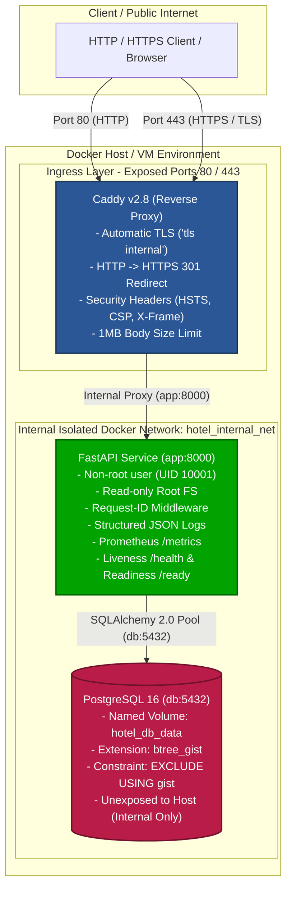

# System Architecture & Network Topology

## 1. Overview
The Hotel Reservation Platform is built as a zero-trust, cloud-native microservice architecture designed for deterministic deployment, strict concurrency safety, and observable operation.

---

## 2. CI/CD & Deployment Pipeline Architecture

```mermaid
flowchart LR
    subgraph Developer_Workspace [Developer Workspace]
        Code[Code Changes] --> GitPush[git push / PR]
    end

    subgraph GitHub_Actions [GitHub Actions CI/CD Pipeline]
        direction TB
        Lint["1. Lint & Static Analysis\n- ruff check\n- ruff format\n- mypy"]
        Test["2. Automated Tests\n- Service: Postgres 16\n- 19 Pytest Cases\n- Concurrency Suite\n- Coverage Artifact"]
        Sec["3. Security Scanning\n- Gitleaks (Secrets)\n- Pip-Audit (Deps)\n- Trivy (FS Scan)"]
        Build["4. Container Build & Smoke\n- Docker Buildx + Cache\n- Trivy Image Scan\n- Compose Smoke Test"]
        Pub["5. Publish to GHCR\n- Multi-arch Tagging\n- Digest Capture\n- Step Summary"]

        Lint --> Test --> Sec --> Build --> Pub
    end

    subgraph Registry [GitHub Container Registry]
        GHCR[("ghcr.io/algions/hotel-reservation-api\n- :v1.0.0\n- :sha-7a1b2c3\n- Immutable Digest")]
    end

    subgraph Target_Host [Production VM / Host]
        DeployScript["deploy.sh\n- Pull Pinned Tag\n- Compose Up with Prod Override\n- Await Healthcheck\n- Record Audit Digest"]
    end

    GitPush --> Lint
    Pub -- "Push Immutable Image" --> GHCR
    GHCR -- "Pull Pinned Release" --> DeployScript
```

---

## 3. Network Topology & Port Map

| Component | Container Name | Internal Port | Host Port | Protocol | Exposure | Purpose |
| :--- | :--- | :--- | :--- | :--- | :--- | :--- |
| **Caddy Reverse Proxy** | `hotel_proxy` | `80`, `443` | `80`, `443` | HTTP, HTTPS | **Public** | TLS termination, HTTP->HTTPS redirect, ingress routing |
| **FastAPI Backend** | `hotel_app` | `8000` | *None* | HTTP | **Internal Only** | Business API, Prometheus metrics, health checks |
| **PostgreSQL Database**| `hotel_db` | `5432` | *None* | TCP | **Internal Only** | Relational data persistence, GiST exclusion constraints |

### Security Boundaries
1. **Network Segmentation**: Only the Caddy reverse proxy publishes ports to the host network interface. Both `hotel_app` and `hotel_db` reside exclusively on the private `hotel_internal_net` bridge network.
2. **Non-Root Execution**: The application container executes under a dedicated unprivileged user (`appuser`, UID `10001`, GID `10001`) with no login shell (`/sbin/nologin`).
3. **Capability Dropping**: Docker Compose drops all Linux capabilities (`cap_drop: [ALL]`) and enforces `no-new-privileges: true`.
4. **Secret Isolation**: Production database credentials are injected exclusively via environment variables or Docker Secrets (`*_FILE` pattern), never committed to source control.

