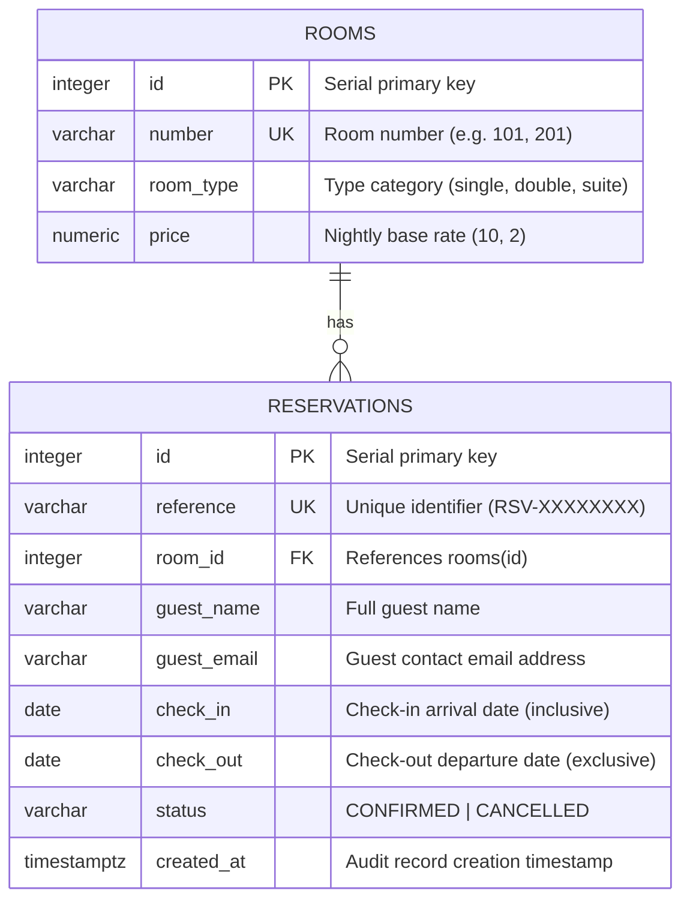

# Database Schema & Entity Relationship Architecture

## 1. Entity-Relationship Diagram



---

## 2. Table Specifications

### 2.1. `rooms` Table
Holds the hotel inventory room numbers, categories, and nightly rates.

```sql
CREATE TABLE rooms (
    id SERIAL PRIMARY KEY,
    number VARCHAR(32) NOT NULL UNIQUE,
    room_type VARCHAR(64) NOT NULL,
    price NUMERIC(10, 2) NOT NULL
);

CREATE INDEX ix_rooms_number ON rooms(number);
CREATE INDEX ix_rooms_room_type ON rooms(room_type);
```

### 2.2. `reservations` Table
Tracks reservations with concurrency protection and relational constraints.

```sql
CREATE TABLE reservations (
    id SERIAL PRIMARY KEY,
    reference VARCHAR(32) NOT NULL UNIQUE,
    room_id INTEGER NOT NULL REFERENCES rooms(id) ON DELETE CASCADE,
    guest_name VARCHAR(128) NOT NULL,
    guest_email VARCHAR(128) NOT NULL,
    check_in DATE NOT NULL,
    check_out DATE NOT NULL,
    status VARCHAR(32) NOT NULL DEFAULT 'CONFIRMED',
    created_at TIMESTAMPTZ NOT NULL DEFAULT CURRENT_TIMESTAMP,
    CONSTRAINT check_valid_date_range CHECK (check_out > check_in)
);

CREATE INDEX ix_reservations_reference ON reservations(reference);
CREATE INDEX ix_reservations_room_id ON reservations(room_id);
CREATE INDEX ix_reservations_check_in ON reservations(check_in);
CREATE INDEX ix_reservations_check_out ON reservations(check_out);
```

---

## 3. Concurrency Safety: GiST Exclusion Constraint

### 3.1. The Double-Booking Race Condition Problem
In standard relational architectures, application-level checks (`SELECT COUNT(*) WHERE ...`) suffer from the Time-Of-Check to Time-Of-Use (TOCTOU) race condition. When two concurrent requests arrive simultaneously for the same room and date range:
1. Both requests execute the `SELECT` check before either transaction commits.
2. Both requests observe zero conflicting bookings.
3. Both requests execute `INSERT`.
4. Both transactions commit, creating an unacceptable double-booking.

### 3.2. PostgreSQL GiST Exclusion Constraint Implementation
To enforce mutual exclusion at the database engine level, we employ the PostgreSQL `btree_gist` extension and an `EXCLUDE` constraint:

```sql
-- Step 1: Enable extension for GiST index support across integer and range types
CREATE EXTENSION IF NOT EXISTS btree_gist;

-- Step 2: Add Exclusion Constraint on reservations table
ALTER TABLE reservations
ADD CONSTRAINT exclude_overlapping_confirmed_reservations
EXCLUDE USING gist (
    room_id WITH =,
    daterange(check_in, check_out, '[)') WITH &&
)
WHERE (status = 'CONFIRMED');
```

### 3.3. Mathematical Interval Algebra & Back-to-Back Stays
- **Half-Open Intervals**: Dates are evaluated as `[check_in, check_out)`, where `check_in` is inclusive and `check_out` is exclusive.
- **Overlap Operator (`&&`)**: In PostgreSQL range algebra, two half-open ranges $[A_{in}, A_{out})$ and $[B_{in}, B_{out})$ overlap if and only if:
  $$A_{in} < B_{out} \quad \text{AND} \quad A_{out} > B_{in}$$
- **Back-to-Back Bookings**: If Guest A reserves `[2026-12-01, 2026-12-05)` and Guest B requests `[2026-12-05, 2026-12-10)`:
  - $A_{out} = 2026-12-05$ and $B_{in} = 2026-12-05$.
  - Because $A_{out} > B_{in}$ is FALSE ($2026-12-05 > 2026-12-05$ is False), the intervals **do not overlap**.
  - Guest A departs at checkout time on Dec 5, and Guest B arrives on Dec 5. Both bookings confirm without conflict.
- **Concurrent Overlap Rejection**: If Guest C attempts to book `[2026-12-03, 2026-12-07)` concurrently, the GiST index immediately raises an `ExclusionViolation` error, which the FastAPI service intercepts and returns as `HTTP 409 Conflict`.

